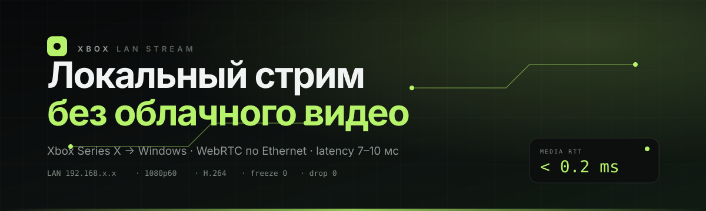
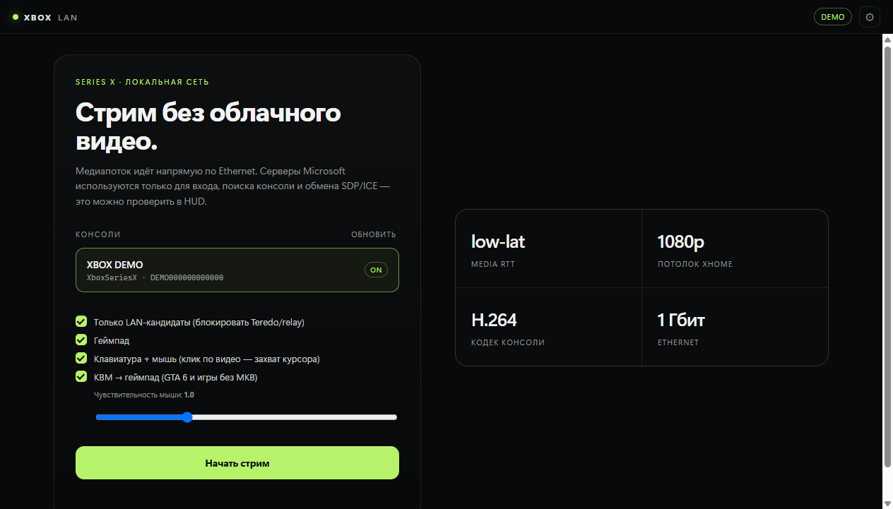

# Xbox LAN Stream

<p align="center">
  
</p>


**English** | [Р СѓСЃСЃРєРёР№](README.md)

A minimal Windows client for **local** Xbox Series X streaming with a real-time
`latency / RTT / bitrate / decode / loss` HUD.

> Unofficial project. Not affiliated with Microsoft or Xbox. Use at your own
> risk; never publish your tokens.

<p align="center">
  
</p>

## What this is

Xbox Remote Play uses the `xHome` protocol:

- **Control plane via Microsoft:** MSAL login, console discovery, session
  provisioning, SDP/ICE exchange, keepalive.
- **Media plane direct on LAN:** WebRTC/SRTP between the console and the PC,
  normally over a host candidate pair (`192.168.x.x`).

This project keeps the media path predictably local, shows the selected
candidate pair, and adds low-latency presentation, metrics, sharpening, and a
keyboard/mouse в†’ virtual gamepad mode.

**You cannot remove Microsoft entirely:** the session cannot start without the
xHome handshake. The video itself normally never goes through Microsoft.

## Features

- Direct LAN ICE policy; filters Teredo/VPN/relay candidates and SDP candidates.
- H.264 codec preference, `b=AS` + `b=TIAS` bitrate hints.
- WebGL2 Catmull-Rom upscale + RCAS-like sharpening (FSR1-style, not FG).
- `--disable-gpu-vsync` + `--disable-frame-rate-limit` presentation
  (measured pipeline ~20 ms → **7–10 ms**).
- HUD: latency, RTT, ICMP, bitrate, FPS, decode, jitter buffer, loss, jitter,
  freeze, dropped frames, path.
- Stall detection + automatic I-frame request.
- Keyboard/mouse passthrough **and** KBM в†’ virtual Xbox gamepad with context
  profiles (`ON FOOT / VEHICLE / AIRCRAFT / BICYCLE`).
- Experimental **Smooth 30в†’45/60** crossfade (off by default; +1 frame latency).
- ICS / NAT fallback scripts and NIC tuning.

## Architecture

```
Xbox Series X (xHome host, HW H.264)
        в”‚  SRTP/UDP, direct L2
        в–ј
Windows PC — Electron / Chromium
  main:  MSAL auth В· loopback xHome proxy В· ICS/NAT В· ICMP
  renderer: RTCPeerConnection В· HW decode В· WebGL upscale В· metrics
        в”‚  HTTPS control plane only
        в–ј
Microsoft: MSAL В· XSTS В· gssv xHome (/servers, /sessions, /sdp, /ice)
```

## Quick start

Requirements: Windows 10/11, Node.js 22+, git.

```powershell
git clone https://github.com/OWNER/xbox-lan-stream.git
cd xbox-lan-stream
npm install
npm run setup:player     # clones and builds xbox-xcloud-player (once)
npm start
```

First run: **Sign in with Microsoft** в†’ device code в†’ select console в†’ Start.
`F1` HUD, `F3` decode overlay, `F4` pad profile, `F11` fullscreen, `Esc` stop.

If the Electron binary was not downloaded:

```powershell
node node_modules/electron/install.js
```

## Metrics

| Field | Source |
|---|---|
| `latency` | `RTT/2 + (expectedDisplayTime в€’ receiveTime)` (+ smooth delay) |
| `RTT` | selected candidate-pair `currentRoundTripTime` |
| `bitrate` | `inbound-rtp.bytesReceived` delta |
| `decode` | `totalDecodeTime / framesDecoded` |
| `buffer` | `jitterBufferDelay / jitterBufferEmittedCount` |
| `loss` | `packetsLost / (packetsLost + packetsReceived)` |
| `freeze` / `drop` | `totalFreezesDuration` / `framesDropped` |
| `path` | remote candidate (`LAN` / `WAN` / `RELAY`) |

Measured on a real Series X over Ethernet: 1080p60, H.264 Main 4.2,
decode 0.25–0.4 ms, jitter buffer 0.2–0.9 ms, pipeline 7–10 ms, `freeze=0`,
`drop=0`. The game encoder still sets the bitrate ceiling (~7–25 Mbps depending
on content).

## Limitations

- xHome is 1080p H.264; no 4K/HDR/HEVC/AV1/120 fps.
- Microsoft control plane is required for every new session.
- Dev Mode does not expose a game-capture/streaming API.
- FSR 3 Frame Generation cannot run on a decoded video stream; the experimental
  Smooth mode is crossfade only and adds latency/ghosting.
- Unofficial client; Microsoft can change the protocol at any time.

## Documentation

- [Русская документация](README.md) — full setup, network, ICS/NAT, metrics.
- [`docs/RESEARCH.md`](docs/RESEARCH.md) — protocol notes and experiments.
- [`docs/GTA6-KEYMAP.md`](docs/GTA6-KEYMAP.md) — KBM → gamepad mapping.
- [`docs/SMOOTH-30-45.md`](docs/SMOOTH-30-45.md) — Smooth 30→45/60.

## License

MIT. Xbox and Series X are trademarks of Microsoft.

