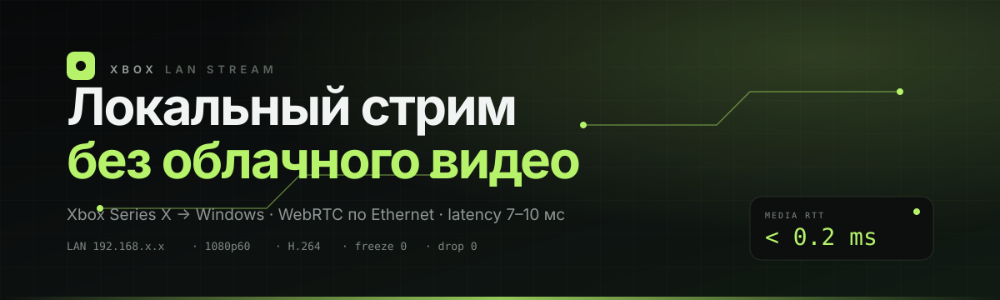
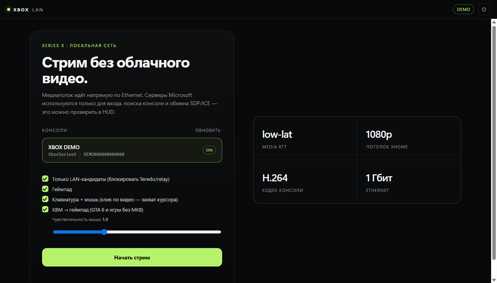

# Xbox LAN Stream

<p align="center">
  
</p>


**Р СѓСЃСЃРєРёР№** | [English](README.en.md)

Минималистичный клиент для локального стриминга Xbox Series X на Windows с HUD
`latency / RTT / bitrate / decode / loss`.

> Неофициальный проект. Не аффилирован с Microsoft/Xbox. Используйте на свой
> риск и не публикуйте свои токены.

**Главный вывод исследования:** полностью убрать серверы Microsoft нельзя, но и
видео через них обычно **не идёт**. В протоколе `xHome` облако — это control plane
(вход, поиск консоли, провижининг сессии, обмен SDP/ICE), а медиа — WebRTC/SRTP
напрямую между консолью и ПК. Этот проект делает медиапуть предсказуемо локальным,
показывает в HUD, какой candidate-pair реально выбран, и даёт инструменты для
чистого L2-сегмента PC↔Xbox.

Дополнительно:

* Порядок кодеков с H.264 **High** первым (Series X всё равно выбирает Main 4.2).
* `b=AS` + `b=TIAS` до 25–40 Mbps, насколько это примет энкодер консоли.
* WebGL2 **bicubic upscale + sharpen** (FSR1-style) против «мыла» на 1440p/4K.
* Экспериментальный **Smooth 30→45/60** (crossfade, +1 кадр, off by default).
* **Клавиатура + мышь** с raw pointer lock и колесом.
* **KBM → виртуальный геймпад** для игр без MKB (GTA 6): WASD, мышь, триггеры.
* Метрики `jitter`, `freeze`, `drop`, детект stall + автоматический запрос I-frame.
* `scripts/tune-nic.ps1` — отключение interrupt moderation/EEE/power saving.

---

## Содержание

- [1. Что на самом деле делает Microsoft](#1-что-на-самом-деле-делает-microsoft)
- [2. Архитектура](#2-архитектура)
- [4. Видеоконвейер и задержка](#4-видеоконвейер-и-задержка)
- [5. Метрики](#5-метрики-что-именно-измеряется)
- [6. Сборка и запуск](#6-сборка-и-запуск)
- [7. Настройка Xbox, ПК и сети](#7-настройка-xbox-пк-и-сети)
- [8. Ограничения и риски](#8-ограничения-и-риски)
- [9. План развития](#9-план-развития)
- [10. Ключевые фрагменты](#10-ключевые-фрагменты)
- [11. Источники](#11-источники-и-переиспользуемые-компоненты)

<p align="center">
  
</p>

Дополнительные документы:

- [`docs/GTA6-KEYMAP.md`](docs/GTA6-KEYMAP.md) — KBM → геймпад для GTA 6
- [`docs/SMOOTH-30-45.md`](docs/SMOOTH-30-45.md) — экспериментальный 30→45/60
- [`docs/RESEARCH.md`](docs/RESEARCH.md) — протокол xHome и план экспериментов
- [`SECURITY.md`](SECURITY.md) — токены и приватность
- [`CONTRIBUTING.md`](CONTRIBUTING.md) — как собрать и прислать PR

---

## 1. Что на самом деле делает Microsoft

| Этап | Куда идёт трафик | Можно ли убрать |
|---|---|---|
| Вход в аккаунт (MSAL device code) | `login.microsoftonline.com`, `xsts.auth.xboxlive.com` | Нет. Нужен Xbox-аккаунт и токен |
| Получение streaming-токена | `xhome.gssv-play-prod.xboxlive.com/v2/login/user` | Нет |
| Список консолей | `GET /v6/servers/home` (regional `*.gssv-play-prodxhome.xboxlive.com`) | Нет публичного локального API |
| Старт сессии | `POST /v5/sessions/home/play` | Нет |
| SDP / ICE / MSAL `/connect` / keepalive | те же `*.gssv-play-prodxhome.xboxlive.com` | Нет, это сигналинг |
| **Видео и звук (RTP/SRTP/UDP)** | **напрямую на LAN-адрес консоли** | **Да, и так работает по умолчанию** |
| Телеметрия клиента | Microsoft | Отключена в нашем запросе сессии |

Почему так: открытый клиент `xbox-xcloud-player` создаёт
`new RTCPeerConnection({})` **без STUN/TURN**, обменивается offer/answer и ICE
кандидатами через xHome API, а затем получает медиа по выбранному candidate-pair.
В `src/lib/stats.ts` он даже классифицирует remote candidate как локальный по
RFC1918. То есть видео уже P2P; облако добавляет только задержку рукопожатия
(секунды при старте), а не задержку кадра.

> Если в HUD path = `LAN 192.168.x.x` и RTT ≈ 0.3–1 мс — видео не проходит через
> Microsoft. Если `WAN`/`RELAY` — ICE не нашёл локальную пару, и вот тогда трафик
> может уходить через IPv6/Teredo или ретранслятор.

### 1.1 Замеры на реальной консоли

Series X, Ethernet 1 Gbps, оба устройства в `192.168.1.0/24`:

* media path: `<PC-LAN-IP>` ↔ `<XBOX-LAN-IP>:9002`, `host/udp`;
* RTT < 0.2 РјСЃ, loss 0.00%, jitter 0;
* 1920×1080, H.264 **Main 4.2**, 59–60 fps, 7–10 Mbps на дашборде;
* decode 0.25–0.4 мс, jitter buffer 0.2–0.9 мс;
* pipeline (receive→display): 7–10 мс в max-режиме, 15–20 мс с vsync;
* `freeze=0`, `drop=0` за 30 секунд; MKB и геймпад отправляют пакеты.

Цифры зависят от игры/сцены; на динамичной игре битрейт и нагрузка выше.

### 1.2 Что нельзя исправить архитектурой

* **4K/HDR, HEVC, AV1, 120 fps** — xHome-хост Series X отдаёт H.264 1080p60.
  Клиент не может выбрать кодек, которого нет в SDP консоли. `H.265/AV1` в
  требованиях относятся к *своему* хосту (Sunshine/ffmpeg), а не к Xbox.
* **Сотни Мбит/с** — битрейт задаёт аппаратный энкодер консоли. SDP `b=AS`
  работает как верхняя граница, но реальный потолок xHome обычно ~15–25 Mbps.
* **Задержка 2 мс** — это достижимое время *декодирования кадра* на NVDEC/QSV,
  но не glass-to-glass. Реалистичный ориентир всего тракта — 50–100 мс.

---

## 2. Архитектура

```
в”Њв”Ђв”Ђв”Ђв”Ђв”Ђв”Ђв”Ђв”Ђв”Ђв”Ђв”Ђв”Ђв”Ђв”Ђв”Ђв”Ђв”Ђв”Ђв”Ђв”Ђв”Ђв”Ђв”Ђв”Ђв”Ђв”Ђв”Ђв”Ђв”Ђв”ђ
в”‚ Xbox Series X               в”‚
в”‚  xHome host                 в”‚
в”‚  HW H.264 encoder + Opus    в”‚
└──────────────┬──────────────┘
               в”‚  SRTP / UDP, РїСЂСЏРјРѕР№ L2
               │  192.168.1.x  или  192.168.137.x (ICS)
в”Њв”Ђв”Ђв”Ђв”Ђв”Ђв”Ђв”Ђв”Ђв”Ђв”Ђв”Ђв”Ђв”Ђв”Ђв–јв”Ђв”Ђв”Ђв”Ђв”Ђв”Ђв”Ђв”Ђв”Ђв”Ђв”Ђв”Ђв”Ђв”Ђв”Ђв”Ђв”Ђв”Ђв”Ђв”Ђв”Ђв”Ђв”Ђв”Ђв”Ђв”Ђв”Ђв”Ђв”Ђв”Ђв”Ђв”Ђв”Ђв”Ђв”Ђв”Ђв”Ђв”Ђв”Ђв”Ђв”Ђв”Ђв”Ђв”Ђв”Ђв”Ђв”Ђв”ђ
│ Windows PC — Electron 45 / Chromium                          │
в”‚                                                              в”‚
в”‚  main process                                                в”‚
в”‚   в”њв”Ђ AuthManager (xal-node, MSAL device code, token store)   в”‚
в”‚   в”њв”Ђ loopback proxy 127.0.0.1:<port>  в†’  xHome HTTPS         в”‚
в”‚   в”њв”Ђ ICS / NIC diagnostics (PowerShell)                      в”‚
в”‚   в””в”Ђ ICMP ping                                               в”‚
в”‚                                                              в”‚
в”‚  renderer (sandboxed, contextIsolation)                      в”‚
в”‚   в”њв”Ђ xbox-xcloud-player: RTCPeerConnection, recvonly video   в”‚
в”‚   в”њв”Ђ Chromium hardware decode: D3D11VA / NVDEC / AMF / QSV   в”‚
в”‚   в”њв”Ђ playoutDelayHint = 0, jitterBufferTarget = 0            в”‚
в”‚   в””в”Ђ Metrics: getStats() + requestVideoFrameCallback         в”‚
└──────────────┬───────────────────────────────────────────────┘
               │  HTTPS: только сигналинг, несколько КБ
в”Њв”Ђв”Ђв”Ђв”Ђв”Ђв”Ђв”Ђв”Ђв”Ђв”Ђв”Ђв”Ђв”Ђв”Ђв–јв”Ђв”Ђв”Ђв”Ђв”Ђв”Ђв”Ђв”Ђв”Ђв”Ђв”Ђв”Ђв”Ђв”Ђв”Ђв”Ђв”Ђв”Ђв”Ђв”Ђв”Ђв”Ђв”Ђв”Ђв”Ђв”Ђв”Ђв”Ђв”Ђв”Ђв”Ђв”ђ
в”‚ Microsoft: MSAL, XSTS, gssv xHome            в”‚
в”‚  /servers/home, /sessions/home/play,         в”‚
в”‚  /sdp, /ice, /connect, /keepalive            в”‚
└──────────────────────────────────────────────┘
```

### 2.1 Dev Mode / Direct Connect — почему не путь

В Xbox Dev Home «прямое подключение» — это доступ к **Device Portal** (HTTPS,
порт 11443) для деплоя и отладки UWP-приложений, а не публичный API захвата игры.
Ограничения:

* Dev Mode — отдельная партиция; retail-игры в ней не запускаются, нужен Partner
  Center и переключение консоли (фактически «вторая» система).
* UWP-приложение в песочнице не может захватить чужую игру/весь экран и не имеет
  доступа к аппаратному энкодеру для низколатентного потока.
* Пакеты подписываются dev-сертификатом, который доверен только в Dev Mode; для
  обычного пользователя это нераспространяемо.

Итог: Dev Mode не даёт легального способа «слушать локальные запросы на стрим».
Единственный работающий хост — встроенный xHome.

### 2.2 Свой хост на Xbox (Sunshine и аналоги)

Sunshine требует desktop capture + аппаратный энкодер (NVENC/AMF/QSV) и ОС, где
это доступно. На Xbox Series X нет ни Win32-десктопа, ни доступа к энкодеру из
UWP. `Windows.Media.Capture`/AppCapture предназначены для клипов и системного
UI, а не для произвольного low-latency видеопотока. Поэтому «поставить Sunshine
на Xbox» невозможно; альтернатива — HDMI-карта захвата на ПК, но это уже не
сетевой стриминг консоли.

### 2.3 Как обходят ограничения Greenlight / xbox-xcloud-player

Оба используют один и тот же легальный путь, что и официальное приложение:

1. MSAL device-code в†’ user token в†’ XSTS в†’ gssv token.
2. `GET /v6/servers/home` → `serverId` консоли.
3. `POST /v5/sessions/home/play` → сессия.
4. `POST /sdp`, `POST /ice`, `POST /connect` (LPT-токен), keepalive.
5. WebRTC-медиа напрямую.

Они **не** ретранслируют видео через свои серверы: клиент — обычное Electron-
приложение, серверов у проекта нет. Для xHome трафик после аутентификации
локальный, если ICE выбрал host-пару. (Для xCloud медиа по определению идёт в
Azure — это другой режим, здесь он не используется.)

Наш LAN-фильтр применяется не только к пакету `/ice`, но и к строкам
`a=candidate` внутри SDP offer/answer. Иначе браузер мог бы восстановить
отфильтрованные адреса (VPN/Teredo) прямо из SDP и выбрать их вопреки политике.

### 2.4 ICS: выделенный проводной сегмент

Схема: `роутер/Wi-Fi → ПК → (Ethernet) → Xbox`, где ПК раздаёт интернет через
Internet Connection Sharing. Плюсы: физически отдельный L2, роутер не в пути
видео, предсказуемый jitter. Минусы: ПК становится software-NAT (доп. хоп и CPU),
DHCP на 192.168.137.1, нужны права администратора.

На гигабитном L2-свитче ICS обычно **не нужен** и может добавить задержку. Он
оправдан, если роутер/Wi-Fi дают jitter, если нужна изоляция трафика или если
ПК соединён с интернетом по Wi-Fi, а к Xbox идёт отдельный кабель.

---

## 3. Стек и структура

| Слой | Выбор | Почему |
|---|---|---|
| Shell | Electron 45 | Готовый Chromium с WebRTC, GPU-декодом и `getStats()` |
| Протокол | `xbox-xcloud-player` (MIT) | Проверенная реализация xHome/WebRTC |
| Auth | `xal-node` (MIT) | MSAL device code, без пароля в приложении |
| UI | Vanilla HTML/CSS/JS | Нет бандлера, минимум зависимостей, один экран |
| Метрики | `RTCPeerConnection.getStats()` + rVFC | Точные счётчики Chromium, без внешних библиотек |
| Сеть | Node `http` proxy + PowerShell | Токен не попадает в renderer; ICS через COM API |

```
xbox-lan/
  src/main/main.js        РѕРєРЅРѕ, IPC, switches Chromium
  src/main/auth.js        MSAL device code + xHome gsToken
  src/main/proxy.js       loopback control-plane proxy
  src/main/net.js         ICMP, адаптеры, ICS
  src/preload.js          contextBridge API
  src/renderer/index.html один экран + HUD
  src/renderer/app.js     сессия, SDP/ICE, LAN-фильтр, MKB
  src/renderer/metrics.js latency/bitrate/decode/loss/jitter/freeze
  src/renderer/upscaler.js WebGL2 bicubic + sharpen
  src/renderer/kbm-pad.js KBM → виртуальный Xbox-геймпад
  scripts/ics.ps1         включение/выключение ICS + firewall
  scripts/nat.ps1         fallback через New-NetNat (без DHCP)
  scripts/tune-nic.ps1    отключение interrupt moderation/EEE/power save
  scripts/net-check.ps1   диагностика адаптеров и offload
  scripts/fetch-player.js собирает vendor-библиотеку
```

---

## 4. Видеоконвейер и задержка

### 4.1 Декодирование

ПК только принимает поток, поэтому **NVENC не используется** — это энкодер.
Работает декодер: Chromium выбирает D3D11VA (NVDEC на NVIDIA, VCN на AMD, QSV
на Intel). Нулевое копирование в композитор, без canvas/ffmpeg-прослоек.

Проверить, что декод аппаратный: запустить с `--enable-logging`, открыть
`chrome://gpu` в DevTools (в Electron можно временно включить меню) и смотреть
`Video Decode: Hardware accelerated`.

### 4.2 Буферизация и презентация

Приложение не добавляет очередь кадров: WebRTC-декодер отдаёт кадр в compositor
сразу. Дополнительно выставляются экспериментальные лимиты:

```js
for (const receiver of pc.getReceivers()) {
  receiver.playoutDelayHint = 0;   // секунды, 0 = минимум
  receiver.jitterBufferTarget = 0; // РјСЃ, 0 = РјРёРЅРёРјСѓРј
}
```

`playoutDelayHint` может игнорироваться сборкой Chromium; HUD покажет реальный
`jitterBufferDelay`, а не обещание API.

После декода кадр проходит опциональный WebGL2-проход:
Catmull-Rom 4×4 + unsharp (RCAS-подобный), по умолчанию sharpness 0.42. Он не добавляет кадров задержки,
загружает текстуру и перерисовывает canvas только при новом кадре (60 fps).
Это убирает bilinear-«мыло» при растягивании 1080p на 1440p/4K.

Важно: **FSR 3 Frame Generation нельзя применить к уже декодированному видео** —
ему нужны motion vectors/depth из движка. В приложении сделан spatial upscale
(FSR1-подобный), а не настоящий FG.

Есть экспериментальный **Smooth 30→45/60**: если игра отдаёт 30 fps, клиент
показывает 45/60 кадров в секунду через crossfade между соседними decoded-
кадрами. Это **не** делает игру 45 fps: физика/логика остаются 30 fps, добавляется
~1 исходный кадр задержки (33 мс при 30 fps) и ghosting на движении. Включается
галочкой в настройках, по умолчанию выключен; HUD добавляет `smooth` к latency.
Для GTA 6 предпочтительнее performance-режим игры, если он есть. Детали:
`docs/SMOOTH-30-45.md`.

### 4.3 Клавиатура, мышь и GTA 6

Есть два режима (галочка «KBM → геймпад»):

**1. KBM → виртуальный геймпад (включён по умолчанию).** Для игр, где MKB
официально нет, включая GTA 6. Клиент не отправляет mouse/keyboard report, а
синтезирует обычный gamepad-кадр 60 раз в секунду.

Профили: `ON FOOT` → `VEHICLE` → `AIRCRAFT` → `BICYCLE` (`F4`; `F` сам
переключает пешком ↔ машина). Основное:

* `WASD` — левый стик, мышь — правый стик (слайдер чувствительности);
* `Shift` — LS (спринт), `Space` — A (прыжок / ручник / bunnyhop);
* `Q` — RB (укрытие) на пешком, D-pad Left (радио) в машине;
* `E` — Y (взаимодействие) / LS (сигнал) в машине;
* `F` — Y (вход/выход) + смена профиля;
* `R`/`O` — X (ближний бой), `Ctrl` — B (присесть), `C` — R3 (обзор назад);
* `ЛКМ`/`ПКМ` — RT/LT (огонь/прицел), в машине `ЛКМ` — RB (drive-by);
* `Z` tap — View, hold — D-pad Down; `G` tap — D-pad Right, hold — RB;
* `P` — Menu, `M` — LB, стрелка вверх / средняя кнопка — D-pad Up (телефон);
* колесо — Y (смена оружия), `Shift`+колесо — D-pad Up/Down (зум).

Полная таблица: `docs/GTA6-KEYMAP.md`.

**2. Прямой MKB passthrough.** Для игр с нативной поддержкой: библиотечный
`MouseKeyboard` отправляет мышь/клавиатуру как есть.

В обоих режимах:

* клик по видео — raw pointer lock (`unadjustedMovement`), `Esc` освобождает;
* MKB/виртуальный пад регистрируются после auth-handshake и перерегистрируются
  через 2.5 с (обход `sendGamepadState(0,false)`);
* физический геймпад отключается, пока виртуальный владеет index 0.

Ограничение: это цифровая эмуляция стика, а не XIM; в GTA 6 прицел будет
ощущаться как геймпадный, с автоприцелом игры, а не как нативный mouse-look.

### 4.4 Битрейт и кодеки

Библиотека по умолчанию отдаёт приоритет H.264 **Main** (`4d00`) и вовсе не
включает High (`6400`). Приложение переопределяет `setCodecPreferences` и ставит
РїРѕСЂСЏРґРѕРє High в†’ Main в†’ Extended в†’ Baseline в†’ H.265 в†’ AV1 в†’ VP9/VP8 в†’ FEC.

**Проверено на реальном Series X:** xHome-энкодер всё равно выбирает
`Main 4.2 (4d002a)`; High в answer отсутствует. То есть предложение High
безопасно, но прироста качества на этой прошивке не даёт — не тратьте время на
«включение High» через SDP.

Максимальный битрейт задаётся `b=AS` + `b=TIAS`, но реальный потолок — энкодер
xHome. На тестовой консоли даже при `b=AS:50000` HUD показывал ~7–10 Mbps на
статичном дашборде; в динамичной игре цифра выше, но всё равно упирается в
адаптивный энкодер консоли. На гигабитном кабеле запас сети огромный; узкое
место — консоль, а не Ethernet.

`b=AS` — это лишь верхняя граница: xHome может её игнорировать. Если после
установки 30000–40000 kbps битрейт в HUD не вырос, значит энкодер упёрся в свой
потолок; это не ошибка клиента.

### 4.5 Бюджет задержки (типично, 1080p60)

| Стадия | Оценка |
|---|---|
| Захват + энкодер консоли | 16–33 мс (1–2 кадра) |
| Сеть L2 | < 1 мс |
| Jitter buffer WebRTC | 0–10 мс |
| Декод NVDEC/QSV | 1–3 мс |
| Compositor + vsync | 0–16.7 мс |
| Дисплей | 5–10 мс |
| **Итого** | **~40–80 мс** |

Это не «2 мс»: 2 мс — только декод. Полный тракт ограничен консолью и vsync.
По умолчанию включены `--disable-gpu-vsync` + `--disable-frame-rate-limit`: на
реальном Series X pipeline (receive→display) упал с ~20 мс до **7–10 мс**,
`freeze=0`, `drop=0`, decode 0.2–0.4 мс, jitter buffer 0.3–0.9 мс. Цена —
возможный tearing; `--no-low-latency` возвращает vsync/pacing. К этим цифрам
ещё добавляется захват/энкодер консоли (16–33 мс), который клиент не
контролирует.

Цена max-режима — compositor крутится без frame-rate limit: в замере GPU/renderer
занимали ~1.3 ядра CPU (два процесса по 60–70%), в balanced — ~20% одного ядра.
Переключатель «Max low-latency present» в настройках перезапускает приложение;
там же можно уйти в balanced, если важнее тишина/температура.

---

## 5. Метрики: что именно измеряется

HUD обновляется раз в секунду.

| Поле | Источник | Формула / смысл |
|---|---|---|
| `latency` | candidate-pair + rVFC | `RTT/2 + (expectedDisplayTime − receiveTime)` (+ `1000/fps` при Smooth); оценка, не glass-to-glass |
| `RTT` | `candidate-pair.currentRoundTripTime` | STUN RTT на фактическом media-path |
| `ICMP` | `ping.exe` до IP консоли | Может быть заблокирован; не влияет на поток |
| `bitrate` | `inbound-rtp.bytesReceived` | `О”bytes Г— 8 / О”t / 1e6` |
| `fps` | `framesPerSecond` или `ΔframesDecoded/Δt` | |
| `decode` | `totalDecodeTime / framesDecoded` | Чистое время декодера |
| `buffer` | `jitterBufferDelay / jitterBufferEmittedCount` | Средняя задержка jitter-буфера |
| `loss` | `packetsLost` / (`packetsLost` + `packetsReceived`) | За интервал |
| `jitter` | `inbound-rtp.jitter` | RTP interarrival jitter, РјСЃ |
| `freeze` | `totalFreezesDuration` | Суммарная длительность заморозок, с |
| `drop` | `framesDropped` | Кадры, не дошедшие до рендера |
| `video` | `frameWidth Г— frameHeight`, codec | |
| `path` | remote candidate | `LAN` = RFC1918/`.local`/`fe80`, `WAN`/`RELAY` = плохо |

Если `frameAge > 1.5 с`, HUD показывает `stalled`, а приложение не чаще раза в
4 с просит у хоста I-frame через control-канал. Это лечит «залипание» после
потери опорного кадра, не перезапуская сессию.

Ограничения точности:

* `receiveTime` и `processingDuration` — семантика Chromium; трактуем как
  «получение кадра → показ». Для истинного glass-to-glass нужна камера,
  снимающая экран Xbox и монитор ПК одновременно.
* `RTT` — STUN-пинг media-канала, а не ICMP и не RTT до сервера Microsoft.
* `bitrate` включает RTP-заголовки, поэтому чуть выше «чистого» видеобитрейта.
* `loss` считается по RTP-счётчикам; при NACK/retransmission потери могут
  маскироваться.

---

## 6. Сборка и запуск

Требования: Windows 10/11, Node.js 22+, git, Ethernet на ПК и Xbox.

```powershell
git clone <URL-этого-репозитория> xbox-lan-stream
cd xbox-lan-stream
npm install
npm run setup:player     # git clone + npm ci + webpack (один раз)
npm start
```

Режим по умолчанию уже низколатентный: `--disable-gpu-vsync` +
`--disable-frame-rate-limit` убирают ожидание vblank и frame-rate pacing
(замер: pipeline 20 мс → **7–10 мс**). Если tearing мешает:

```powershell
npm start -- --no-low-latency
```

`--low-latency` оставлен как совместимый алиас (поведение по умолчанию).

Первый запуск:

1. Нажать «Войти через Microsoft», открыть ссылку, ввести код.
2. Выбрать консоль в списке.
3. «Начать стрим». HUD — `F1`, decode — `F3`, профиль пада — `F4`,
   полный экран — `F11`, стоп — `Esc`.

Токен лежит в `%APPDATA%\xbox-lan-stream\.xbox.tokens.json` (или в
`.xbox.tokens.json` рядом с проектом). Это bearer-токен: не публикуйте его.

---

## 7. Настройка Xbox, ПК и сети

### Xbox

* Settings → General → Power options → **Sleep** (не Energy saver), чтобы
  консоль просыпалась по Remote Play.
* Settings в†’ Devices & connections в†’ Remote features в†’ **Enable remote features**.
* Тот же Microsoft-аккаунт, что в приложении; консоль онлайн.
* Xbox подключён Ethernet-кабелем (Wi-Fi на консоли — главный источник jitter).
* Желательно DHCP-reservation/статический IP.

### РџРљ

* Сетевой профиль — **Private** (иначе Windows Firewall режет входящий UDP).
* Отключить power saving на NIC, «Interrupt Moderation» и «Energy Efficient
  Ethernet» — если важна стабильность latency.
* Если в ПК два интерфейса (Ethernet + Wi-Fi), временно отключить Wi-Fi или
  поднять метрику Ethernet, чтобы WebRTC не выбрал не тот путь.
* Диагностика: `npm run net:check`.
* Тюнинг NIC (осторожно, меняет настройки драйвера):

```powershell
# от администратора
npm run nic:tune -- -Alias "Ethernet"
# вернуть как было
npm run nic:tune -- -Alias "Ethernet" -Revert
```

### Роутер / свитч

* ПК и Xbox — в одном L2-сегменте, без client/AP isolation и VLAN между ними.
* Не включать «game accelerator»/QoS, который шейпит UDP.
* Гигабитный свитч достаточен; медиапоток ~20 Mbps, запас огромный.

### ICS (опционально)

```powershell
# от администратора
npm run ics:on -- -PublicAlias "Wi-Fi" -PrivateAlias "Ethernet 2"
# выключить
npm run ics:off
```

Или через UI: шестерёнка → «Прямой сегмент (ICS)» → выбрать public/private.

После включения Xbox получит `192.168.137.x`, ПК — `192.168.137.1`. В HUD путь
должен стать `LAN 192.168.137.x`. Если нет — проверьте firewall и что Xbox
действительно подключён к private-адаптеру.

На некоторых сборках Windows 11 COM-провайдер ICS недоступен
(`SharingInstalled = false`). Тогда используйте NAT fallback — он не раздаёт
DHCP, поэтому IP на Xbox задаётся вручную:

```powershell
npm run nat:on -- -PublicAlias "Wi-Fi" -PrivateAlias "Ethernet 2"
# Xbox: IP 192.168.137.2, mask 255.255.255.0, gateway 192.168.137.1, DNS 1.1.1.1
npm run nat:off
```

В UI это кнопки «NAT fallback» / «Убрать NAT». Оба варианта добавляют software-
хоп; на нормальном L2-свитче они не нужны.

### Как убедиться, что видео не идёт через Microsoft

1. Р’ HUD `path` = `LAN ...`, `RTT` < 2 РјСЃ.
2. `remote` в HUD = приватный IP консоли.
3. Wireshark на Xbox-facing NIC: фильтр `udp && ip.addr == <xbox-ip>` показывает
   RTP/SRTP напрямую; трафика видео на IP Microsoft нет.
4. Отключить интернет на 10 секунд во время сессии: видео обычно продолжается
   (сигналинг/keepalive уже не нужны), но новая сессия не стартует.

---

## 7.1. Быстрая диагностика

| Симптом | Причина / действие |
|---|---|
| `npm start` → `electron` not found | `node node_modules/electron/install.js`, затем снова `npm start` |
| «Не найден vendor/xbox-xcloud-player» | `npm run setup:player` |
| HUD `WAN` / `RELAY` | VPN/Teredo, разные подсети, firewall, AP isolation; отключить VPN, проверить `path` |
| `RTT` > 10 мс, `buffer` растёт | Wi-Fi/перегрузка/ретраи; кабель, offload, interrupt moderation |
| `decode` 10–30 мс | декод программный; драйвер GPU, `chrome://gpu`, `--enable-accelerated-video-decode` |
| Микрофризы, `jitter`/`freeze` растут | interrupt moderation/EEE/power save на NIC; `npm run nic:tune`; отключить VPN |
| Smooth 30→45: двоение/задержка | это crossfade, не настоящий 45 fps; выключить или оставить только для 30fps-игр |
| Микрофризы при `loss = 0` | vsync/compositor; low-latency включён по умолчанию; выключить upscale на слабой GPU; попробовать `--no-low-latency` |
| Картинка «мыльная» | включить upscale + sharpen; проверить, что HUD показывает 1920×1080, а не 1280×720 |
| `stalled` в HUD | потерян опорный кадр; приложение само просит I-frame; если повторяется — `loss`/кабель |
| Нет клавиатуры/мыши | клик по видео для pointer lock; `Esc` освобождает; в настройках включён MKB |
| В GTA 6 не работает мышь | включить «KBM → геймпад»; это эмуляция стика, не нативный mouse-look |
| Консолей нет | Xbox онлайн, тот же аккаунт, Remote features, Sleep, не Dev Mode |
| 503 от proxy | токен истёк: «Обновить токен» или войти заново |
| ICS: `SharingInstalled=false` | сборка Windows без COM-провайдера ICS; используйте NAT fallback |

## 8. Ограничения и риски

* **Control plane остаётся у Microsoft.** Вход, список консолей, старт сессии,
  SDP/ICE и keepalive — без них xHome не работает. Полный offline-старт
  невозможен.
* **Медиа может уйти в WAN.** Если ICE не нашёл host-пару (разные подсети,
  mDNS, firewall, IPv6-предпочтение), поток пойдёт через Teredo/relay. HUD это
  покажет; лечится LAN-фильтром, `WebRtcHideLocalIpsWithMdns` (уже включён) и
  сетью.
* **Качество ограничено консолью:** 1080p, H.264, ~15–25 Mbps, stereo Opus,
  без HDR/4K/120 fps.
* **Задержка не 2 мс.** Нижняя граница — энкодер консоли + vsync.
* **FSR 3 Frame Generation недоступен для видео.** Есть только экспериментальный
  crossfade **Smooth 30→45/60**: +1 исходный кадр задержки и ghosting, игра
  остаётся 30 fps по логике. По умолчанию выключен.

* **Неофициальный клиент.** Возможны блокировки/изменения API; используйте на
  свой риск, не распространяйте токены.
* **xHome доступен не всем аккаунтам/регионам.** Зависит от Remote Play,
  подписки и региона; ошибка `gsToken` означает, что аккаунт не стримит.
* **Аудио/микрофон:** включён только приём стерео-Opus; чат-канал не активирован.
* **Клавиатура/мышь:** есть passthrough и KBM→gamepad; в GTA 6 это именно
  эмуляция стика, поэтому прицел геймпадный, а не нативный mouse-look.

---

## 9. План развития

**MVP (этот репозиторий)**
- MSAL device code, список консолей, xHome-сессия.
- WebRTC H.264 + Opus, LAN-фильтр ICE, HUD.
- ICS/firewall-скрипты и диагностика.

**v0.2**
- Автовыбор Xbox-facing NIC и привязка ICE к интерфейсу.
- QoS/DSCP для UDP, отключение offload-настроек из UI.
- Экспорт метрик в CSV, калибровка latency по камере.
- Автопереподключение и обработка смены сети.

**v1.0**
- Упаковка (electron-builder), подпись, автообновление, трей.
- Полноценный чат/микрофон, MKB-маппинг.
- Дальнейшее снижение задержки: нативный декод/презентация без Chromium-
  компоновщика (потребует отдельного плеера на Media Foundation).

---

## 10. Ключевые фрагменты

### LAN-фильтр ICE (`src/renderer/app.js`)

```js
let localCandidates = player.getIceCandidates().filter((c) => c.candidate);
if (state.forceLan) {
  const lanOnly = localCandidates.filter((c) => isLocalCandidate(c.candidate));
  if (lanOnly.length) localCandidates = lanOnly;
}
// ... send to /ice ...
if (state.forceLan) {
  const lanOnly = remoteCandidates.filter((c) => isLocalCandidate(candidateString(c)));
  if (lanOnly.length) remoteCandidates = lanOnly;
}
player.setRemoteIceCandidates(remoteCandidates);
```

### Метрики (`src/renderer/metrics.js`)

```js
bitrate = (d('bytesReceived') * 8) / (delta / 1000) / 1e6;
decodeMs = (d('totalDecodeTime') / d('framesDecoded')) * 1000;
bufferMs = (d('jitterBufferDelay') / d('jitterBufferEmittedCount')) * 1000;
loss = d('packetsLost') / (d('packetsLost') + d('packetsReceived')) * 100;
rtt = pair.currentRoundTripTime * 1000;
latency = rtt / 2 + smooth.pipeline; // pipeline = expectedDisplayTime - receiveTime
```

### ICS (`scripts/ics.ps1`)

```powershell
$publicConfig.EnableSharing(0)   # public
$privateConfig.EnableSharing(1)  # private
New-NetIPAddress -InterfaceAlias $PrivateAlias -IPAddress 192.168.137.1 -PrefixLength 24
New-NetFirewallRule -DisplayName 'Xbox LAN Stream (WebRTC UDP)' `
  -Direction Inbound -Protocol UDP -LocalPort 1024-65535 `
  -InterfaceAlias $PrivateAlias -Profile Private -Action Allow
```

---

## 11. Источники и переиспользуемые компоненты

* `xbox-xcloud-player` — WebRTC-клиент xHome/xCloud, MIT:
  https://github.com/unknownskl/xbox-xcloud-player
* `greenlight` — готовое Electron-приложение на той же библиотеке, MIT:
  https://github.com/unknownskl/greenlight
* `xal-node` — XAL/MSAL-аутентификация, MIT:
  https://github.com/unknownskl/xal-node
* MDN: `RTCRtpReceiver.playoutDelayHint`, `HTMLVideoElement.requestVideoFrameCallback`,
  `RTCInboundRtpStreamStats` (totalDecodeTime, jitterBufferDelay).
* Microsoft Learn: Xbox Dev Mode / Device Portal — деплой и отладка, не стриминг.

---

## 12. Лицензия и дисклеймер

Код приложения — MIT. `xbox-xcloud-player` и `xal-node` подключаются как
отдельные MIT-зависимости. Проект не аффилирован с Microsoft/Xbox. Xbox,
Series X, xCloud — товарные знаки Microsoft. Использование неофициального
клиента может нарушать условия сервиса; ответственность на пользователе.

